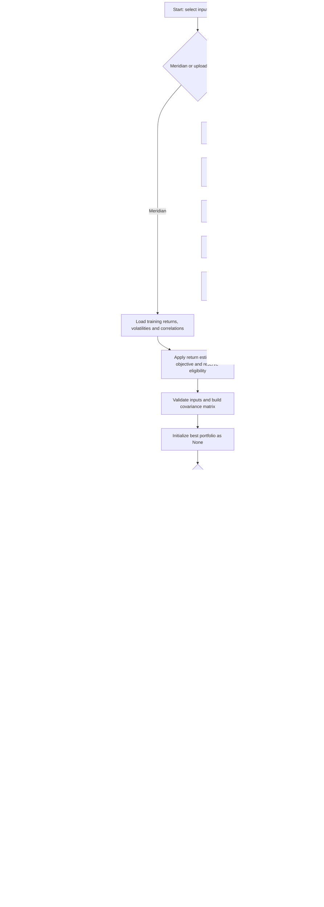

# Lab 15 — Portfolio Stability Decision

Brandon Oganovich | FIN43900 | October 22, 2026

## Decision — AI-assisted draft

Reject the current **VTI / QQQ / VOO / SCHD** universe as a complete starting allocation under the existing mandate: none of these equity ETFs qualifies for the required 3% government-security reserve. The search returns no feasible mix on both estimation windows; there is no allocation to adopt and no numerical weight change to report. This is an honest mandate conflict, not a software failure.

I would reconsider a pilot only after an authorized mandate or universe change makes the reserve requirement satisfiable, followed by a fresh search and stability/cost tests. The reported Meridian partner attack still illustrates why feasibility alone is insufficient: lowering IG's return estimate by one point removes its 25% allocation. No reserve-rule waiver or additional reserve asset has been assumed.

## Files and use

`portfolio.py` retains Lab 14's printed output and adds the grid search and CSV estimator. `app.py` imports those functions and the Meridian inputs; there is no second risk engine in the app.

With a standard Python installation:

```powershell
python -m pip install -r requirements-lab15.txt
python portfolio.py
python -m unittest test_portfolio test_lab15 test_lab15_app -v
python -m streamlit run app.py
```

To regenerate the full source-data reconciliation and test record, run `python verify_lab15.py` (or use the bundled executable with `verify_lab15.py`).

The app starts with Meridian's 6.5% objective and 3% reserve requirement. For Project 2, upload the updated `prices.csv`, set the objective to 5.5%, retain the 3% reserve floor, and leave VTI, QQQ, VOO and SCHD reserve boxes unchecked. Both windows should display "no mix meets the objective" because the reserve condition fails. Do not reduce the reserve floor or falsely mark an equity ETF eligible to force a result. Both panels use the same controls; the comparison panel uses unedited all-month estimates.

This workspace also has a bundled Python runtime and locally installed dependencies. From this project folder, launch without relying on Python being on PATH:

```powershell
.\tmp\python-3.12.10-embed-amd64\python.exe run_lab15.py
```

## Mandate and assumptions

The existing fictional Campus Access Scholarship Reserve mandate has USD 2 million, a ten-year horizon, quarterly USD 15,000 payouts, and a USD 60,000 reserve requirement. The reserve floor is 60,000 / 2,000,000 = 3%. For this lab, CPI + 3 percentage points becomes a **5.5% nominal annual objective**, assuming 2.5% CPI; the inflation input is an educational assumption, not a current CPI observation. No objective is lowered to force feasibility.

The engine searches fully invested, long-only allocations in increments of five percentage points. It minimizes annual estimated standard deviation among mixes meeting the return and reserve floors. A 3% reserve minimum therefore requires at least 5% on this grid. Exact risk ties retain the first enumerated allocation. Grid optimality does not establish the continuous optimum or client suitability.

Historical estimates are gross of separately modeled advisory/trading costs and taxes; no such deductions are supplied. Adjusted ETF prices reflect fund distributions and fund-level effects, but this does not establish the mandate's net-of-costs target. The app does not enforce issuer look-through, redemption timing, turnover, or future loss limits. All four selected ETFs are equity funds and none is eligible for the existing cash/government-security reserve rule; dividend income does not make SCHD a cash reserve. Meridian's training inputs remain separate and unchanged.

## Sources and historical sample

The replacement dataset was downloaded **2026-10-22**, with exact endpoint URLs and timestamp in `lab15_data/metadata.json` and original Yahoo responses in that folder. Regenerate it with `download_lab15_prices.py`. The prior universe's CSV is preserved in `lab14_data/prices.csv` for historical regression tests; it is not the current Project 2 universe.

| Ticker | Role | Recorded historical source | Download date (UTC) |
|---|---|---|---|
| VTI | Broad U.S. equity exposure | [Yahoo VTI history](https://finance.yahoo.com/quote/VTI/history/) | 2026-10-22 |
| QQQ | Nasdaq-100 equity exposure | [Yahoo QQQ history](https://finance.yahoo.com/quote/QQQ/history/) | 2026-10-22 |
| VOO | S&P 500 equity exposure | [Yahoo VOO history](https://finance.yahoo.com/quote/VOO/history/) | 2026-10-22 |
| SCHD | U.S. dividend equity exposure | [Yahoo SCHD history](https://finance.yahoo.com/quote/SCHD/history/) | 2026-10-22 |

Fund roles are supported by the providers: [VTI](https://advisors.vanguard.com/investments/products/vti/vanguard-total-stock-market-etf), [QQQ](https://www.invesco.com/qqq-etf/en/home.html), [VOO](https://advisors.vanguard.com/investments/products/voo/vanguard-sp-500-etf), and [SCHD](https://www.schwabassetmanagement.com/products/schd). These are four funds, not four independent asset classes: their equity exposures overlap. Using adjusted prices is particularly important for distributions and corporate actions such as SCHD's 2024 share split.

`prices.csv` has 60 monthly adjusted-price observations, October 29, 2021 through September 30, 2026, sampled at each completed month's last trading observation. This yields **59 monthly returns**, November 2021 through September 2026. The last-36 window uses returns October 2023 through September 2026, requiring 37 prices. Prices are USD; results are percentages, without currency conversion. The current provenance audit is in `lab15_verification.txt`.

## Formulas and engine flow

Monthly simple return = current adjusted price / previous adjusted price − 1. Annual return estimate = arithmetic mean of monthly returns × 12; this is not CAGR. Annual volatility estimate = sample monthly standard deviation × √12, with denominator n − 1. Correlations use the same paired months. Annual covariance is correlation × annual volatility i × annual volatility j. Portfolio return is Σ(weight × estimate), variance is wᵀΣw, and volatility is its square root. Annualization is a conventional approximation and does not model serial dependence.

Missing, nonpositive, nonfinite or malformed prices, duplicate/unsorted dates and missing calendar months are rejected. Constant-price assets have zero volatility and zero off-diagonal covariance; the estimator uses zero off-diagonal correlation as a computational convention. Precision is retained until display.



## Meridian verification

All rows are calculated by the engine; weights are ordered bills / 10-year Treasury / IG / equity.

| Run | Weights (%) | Return estimate (%) | Volatility (%) | Reserve (%) |
|---|---|---:|---:|---:|
| Loaded | 0 / 20 / 25 / 55 | 6.51 | 9.44 | 20.00 |
| Equity estimate 8% → 7% | 0 / 10 / 10 / 80 | 6.53 | 12.94 | 10.00 |
| IG/equity correlation 0.25 → 0.50, equity restored to 8% | 0 / 40 / 0 / 60 | 6.52 | 9.73 | 40.00 |

The return stress changes the largest weight by **25 percentage points**. Lowering equity's expected return requires more equity to satisfy the unchanged target; the risk-minimizing feasible allocation can become riskier. The correlation probe changes both symmetric cells on a copy in the tests; the delivered inputs retain 0.25. To repeat it interactively, change both cells in `portfolio.py`, save, rerun the app, then restore them.

## Project 2 results

| Asset | All-month annual return estimate (%) | Last-36 annual return estimate (%) | All-month volatility (%) | Last-36 volatility (%) |
|---|---:|---:|---:|---:|
| VTI | 12.00 | 21.11 | 15.87 | 12.86 |
| QQQ | 16.04 | 26.39 | 20.84 | 17.26 |
| VOO | 12.99 | 21.49 | 15.57 | 12.45 |
| SCHD | 9.46 | 15.37 | 15.15 | 13.75 |

| Window | Search result at 5.5% objective / 3% reserve | Portfolio weights / return / volatility |
|---|---|---|
| All 59 returns | No mix meets the objective and reserve rule | Not applicable: no feasible portfolio |
| Last 36 returns | No mix meets the objective and reserve rule | Not applicable: no feasible portfolio |

**Largest weight change: not applicable, not zero.** Neither window has a feasible portfolio. Every candidate has 0% reserve-eligible weight, below 3%, regardless of its return estimate. At USD 2 million, this is a USD 60,000 eligible-reserve shortfall. Higher historical returns in the shorter window cannot repair this constraint. No objective or reserve floor was lowered.

The result is stable in its infeasibility; that does not prove stable portfolio weights or investment performance. The previous universe's 15-point shift is no longer a result for the selected funds. Meridian's known-answer and reported partner stresses remain the feasible-allocation sensitivity evidence.
## Partner attack — user-reported, independently reproduced

The supplied partner report used Meridian because the partner did not have `prices.csv`. It changed the IG bond fund's annual expected return estimate from **5.0% to 4.0%**, holding all other inputs, the 6.5% objective and the 3% reserve floor fixed. The report challenged whether a plausible estimation error makes the allocation too fragile to trade. The interaction is reported by the student; the calculations were independently reproduced in both the engine and app tests.

| Measure | Loaded Meridian | IG return estimate reduced |
|---|---:|---:|
| Bills / 10-year / IG / equity weights (%) | 0 / 20 / 25 / 55 | 0 / 40 / 0 / 60 |
| Annual return estimate (%) | 6.51 | 6.52 |
| Annual volatility estimate (%) | 9.44 | 9.73 |
| Reserve weight (%) | 20.00 | 40.00 |

Signed weight changes are **0 / +20 / −25 / +5 percentage points**. The largest absolute change is **25 points in IG only**; the note changes 20 points, correcting the supplied report's description. This is a return-estimate stress, separate from the correlation probe, even though both happen to produce the same allocation.

**Two-sentence response:** Lowering IG's return estimate by one point makes the original mix miss the unchanged 6.5% target, so the lowest-volatility feasible grid mix removes its 25% IG position, adds 20 points to the Treasury note and 5 points to equity, and raises estimated volatility from 9.44% to 9.73%. I would retain a research pilot rather than trade automatically on this fragile estimate, and would reconsider adoption only after independently justified return assumptions and cost-adjusted stress tests support the allocation.

The original mix under the attacked IG estimate returns 6.51% − 25% × 1 percentage point = **6.26%**, which directly explains why it becomes infeasible. If your instructor expects the partner attack specifically on Project 2, repeat the partner exercise with the now-available `prices.csv`; the supplied report establishes a Meridian attack only.

## Estimation risk and reflection — AI-assisted study draft

Estimation risk is the risk that inputs inferred from a limited historical sample differ from future outcomes. A constrained optimizer amplifies input changes because a small return adjustment can make the current mix infeasible and move the lowest-risk solution to a different allocation. The last-36 window changes means, volatilities and correlations together, but neither window solves the reserve shortfall for this equity-only universe. Meridian demonstrates a 25-point allocation change; no corresponding weight-change number exists for the new Project 2 universe.

Before adopting the mix, I would seek a client-approved return assumption, confirm that reserve proxies meet the policy, assess costs and payout stress, and test other estimation windows and adverse scenarios. A single low-volatility sample is insufficient evidence for real implementation.

## Verification record

The updated audit passed **all 22 tests** and reconciled **all 240 new price cells** against recorded Yahoo responses, including the new universe in both windows. The environment is Python 3.12.10 with Streamlit 1.66.1. See `lab15_verification.txt` for the results.

`python verify_lab15.py` regenerates `lab15_verification.txt`, including the recorded-source reconciliation and automated tests. Checks cover the nine existing Lab 14 tests, Meridian's known answers and sensitivity probes, the reported IG attack, hand-calculated estimation, invalid prices/dates, infeasible constraints, the current Project 2 infeasibility in both windows, historical allocation regression cases, and actual Streamlit page reruns. For the preserved prior-universe regression fixture, an independent oracle enumerates all four-fund grid mixes and measures volatility directly from their monthly return series, separately from the engine's covariance calculation; additional checks count all allocations for three through six assets. For CSV interface tests only the uploaded-file widget is simulated; the page and financial calculations run normally. These checks do not claim a manual browser visual review or independently observed partner interaction.

## Rubric evidence map — self-audit, not a promised grade

| Criterion (5 points each) | Evidence provided | Remaining condition |
|---|---|---|
| Training reproduced | Both known Meridian runs, 25-point shift, correlation probe, engine and app tests | Demonstrate the app if requested |
| Data and sources | Per-ticker source/date table, original Yahoo responses, 240-cell reconciliation, estimate labels | Include price data and provenance with the submitted files |
| Search under your mandate | Fixed 5.5% classroom objective, 3% reserve minimum, no eligible assets in the selected equity universe, exhaustive search, infeasibility tests | Net-cost and policy-eligibility limitations are explicit |
| Stability and fresh eyes | Both estimation windows, explicitly undefined weight change due to infeasibility, supplied partner attack, corrected changes, two-sentence response | Partner report uses Meridian; repeat on Project 2 if required |
| The call | Reject decision tied to reserve infeasibility in both windows, explicit condition for reconsidering a pilot | Review and own the decision |

## Personal activities still to complete

The supplied partner attack is recorded above; it does not establish completion of the separate no-AI explanation or paper exercise. The reported partner attack used Meridian, not the new fund universe.

The paper drawing, no-AI oral code explanation, partner question and personal reflection require your participation. Study guide: the search generates integer allocations summing to 20, converts them to weights, filters against both floors, evaluates volatility with the shared covariance matrix, and updates the best result only when risk is lower. Explain why returning `None` is appropriate when no candidate survives. The decision above is an AI-assisted draft for your review.

Submit links to this Markdown file, `portfolio.py` and `app.py`, with `prices.csv`, dependencies and tests as supporting files. No GitHub publication or quiz submission has been performed.

Assignment: [Lab 15 — Portfolio Stability Decision](https://github.com/CinderZhang/FIN43900-Fall2026/blob/main/lessons/week-09/lab-15-portfolio-stability.md).

**Disclaimer: This project was made with Codex. I am not a financial advisor. This project is for educational purposes only and is not investment advice.**

