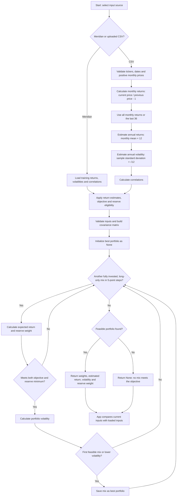

# Portfolio Engine Flowchart

This chart shows the portfolio estimation and search workflow used by the app.

**Disclaimer: This project was made with Codex. I am not a financial advisor. For educational purposes only; this is not investment advice.**

